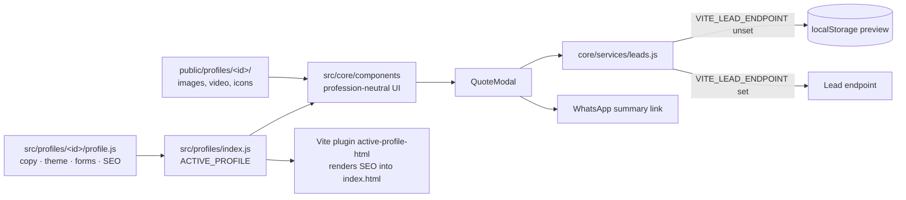

# Professional Services Template

**A reusable, profile-driven React website for independent service businesses: one shared core, and each profession (copy, theme, SEO, forms, assets) lives in its own profile folder. Ships with a fictional Hebrew electrician demo.**

**Live (electrician demo):** https://delevski.github.io/professional-services-template/

[](https://delevski.github.io/professional-services-template/)

## What it does

- **A complete service-business site** from one profile: hero (with a looping background video in the demo), trust points, services, projects, testimonials, packages, the professional's bio and credentials, service areas, FAQ and a final CTA.
- **Quote request modal** with profile-defined work types and urgency choices. A request is saved as a lead and summarized into a **WhatsApp** message to the business.
- **Build-time SEO from the profile**: title, description, locale, canonical URL, icons, social image and structured-data schema are written into `index.html` when the site builds.
- **RTL / LTR and language per profile**: the electrician demo is Hebrew, right-to-left.
- All names, credentials, prices, contact details, projects and testimonials in the demo are fictional.

## Architecture



Key design decisions:

- **Core vs. profile separation.** Shared presentation and behaviour live in `src/core/`; each profession owns its data and assets in an isolated folder. Adding a profession never requires editing another one.
- **One active profile per build.** `src/profiles/index.js` exports `ACTIVE_PROFILE`; a custom Vite plugin applies the deploy `base` to the profile's paths and renders its metadata into the HTML at build time.
- **One repository per real business.** The template is meant to be copied: client profiles and production lead data are never mixed in the demo repo ([`docs/profile-authoring.md`](docs/profile-authoring.md) is the step-by-step guide).
- **Leads behind one function.** `submitLead()` posts to `VITE_LEAD_ENDPOINT` when it is set (provided at build time from a repository variable in the Pages workflow) and falls back to local storage for the demo.
- **Honest structured data.** The authoring guide forbids adding ratings to the schema unless they are real.
- **Contracts in tests.** Vitest covers the app, the quote modal, profile shape, HTML rendering, lead service, WhatsApp links, asset paths, and that the deploy workflow passes the lead endpoint into the build.

## Tech stack

- **React + Vite** (custom HTML-transform plugin)
- **lucide-react** icons, plain CSS
- **Vitest**, Testing Library, jsdom
- **GitHub Actions → GitHub Pages**

## Project structure

```
src/core/          components, hooks, services (leads), utils (whatsapp, assets)
src/profiles/      electrician/profile.js + index.js (ACTIVE_PROFILE)
src/build/         profileHtml.js (build-time HTML + SEO rendering)
public/profiles/   per-profile images, hero video, icons, social preview
docs/              profile authoring and design specs
```

## Run locally

```bash
npm ci
npm run dev
```

Production check:

```bash
npm test -- --run
npm run build
```

New business: copy `src/profiles/electrician/` and `public/profiles/electrician/`, replace every data category, point `ACTIVE_PROFILE` at the new profile, set `base` in `vite.config.js`, and set the `VITE_LEAD_ENDPOINT` repository variable if leads should go to a server.

## Status

Complete template with one demo profile, deployed to GitHub Pages.

## Author

**Or Delevski** · https://ordelwebsite.vercel.app
